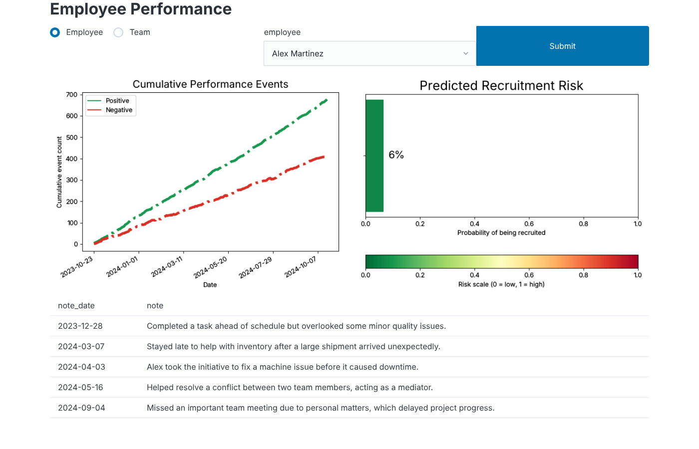
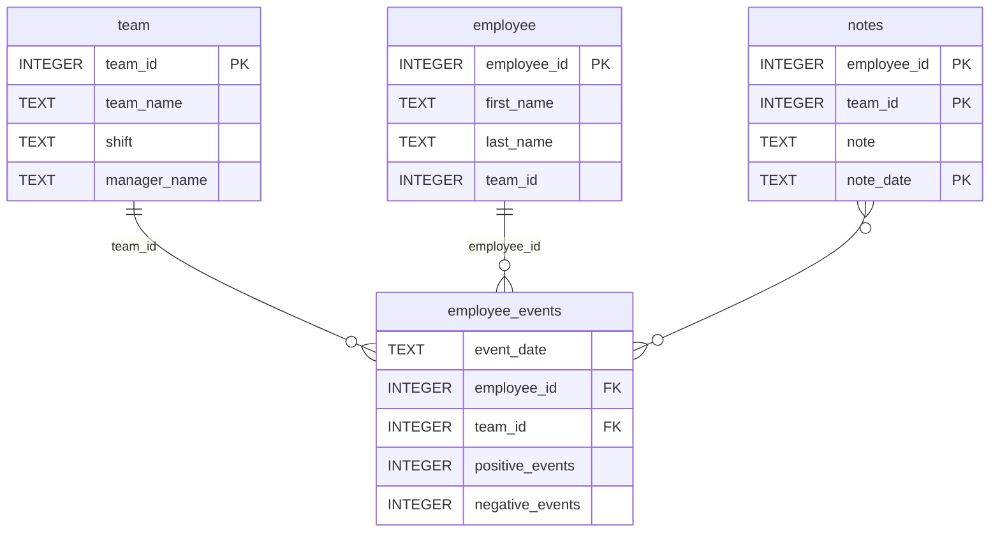
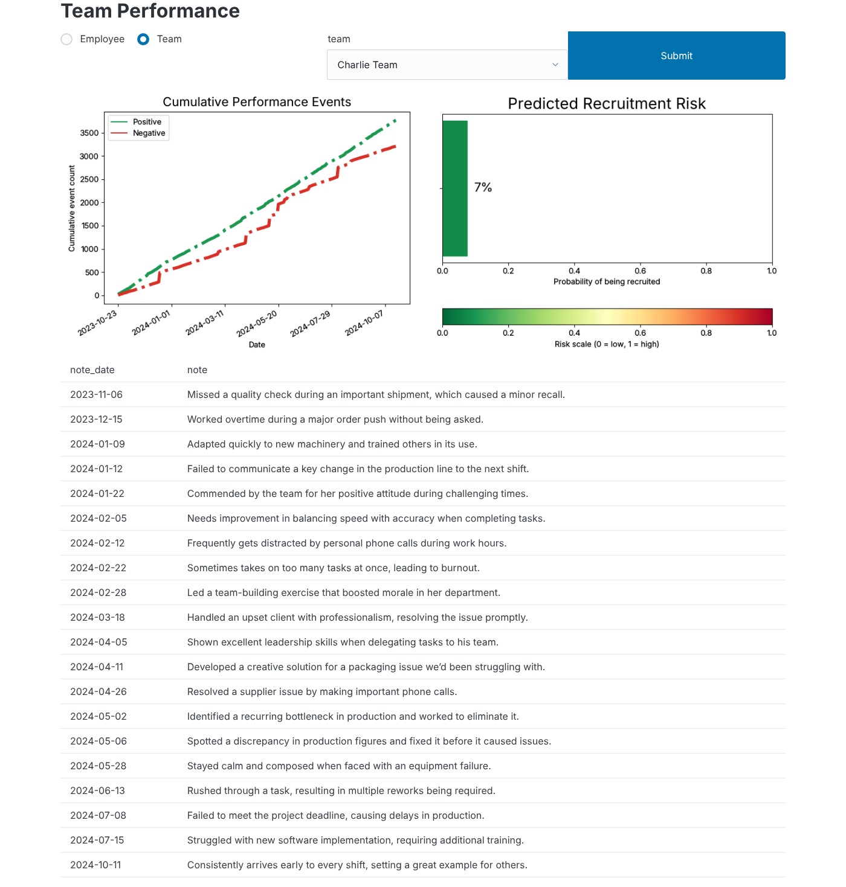

# Employee Events: Python Package & FastHTML Dashboard

*Udacity Data Scientist Nanodegree · Software Engineering for Data Scientists · Lucas Vieira · November 2026*

GitHub: [https://github.com/lucasnvieira](https://github.com/lucasnvieira)

[](https://github.com/lucasnvieira/dsnd-dashboard-project/actions/workflows/test.yml)
[](https://github.com/lucasnvieira/dsnd-dashboard-project/actions/workflows/lint.yml)

How productive is an employee or a team, and how likely is that person (or team) to be recruited by a competitor? In this project, I built a reusable Python package that answers the data part of these questions with SQL, and a FastHTML dashboard that managers can use to see the answer in one page.



## 1. Business scenario

I play the role of a Data Scientist in a manufacturing company. Upper management is worried about losing their best employees to competitors. The data team already did three things:

1. Deployed a form where managers record **positive and negative performance events** for each employee.
2. Stored these inputs in a SQLite database, **`employee_events.db`**.
3. Trained a **machine learning model** (`assets/model.pkl`) that predicts the probability of an employee being recruited by another company.

My job was to deliver a dashboard that:

- shows the **productivity** of one employee or of a whole team, and
- shows the **predicted recruitment risk** of one employee, or the **average risk** of a team.

There is also a technical requirement: each data team must publish a Python API for the databases it works with, so other teams can get business-critical datasets without writing the SQL themselves. That is why the project has two parts, the `employee_events` package and the dashboard that uses it.

## 2. Repository structure

```
├── .github/workflows
│   ├── lint.yml              # flake8 on every push/PR to main
│   └── test.yml              # pytest on every push/PR to main
├── assets
│   ├── model.pkl             # trained recruitment-risk model (provided)
│   └── report.css
├── docs                      # dashboard screenshots used in this README
├── python-package
│   ├── dist
│   │   └── employee_events-0.0.tar.gz   # built package (installed by requirements.txt)
│   ├── employee_events
│   │   ├── __init__.py
│   │   ├── employee.py       # Employee queries
│   │   ├── employee_events.db
│   │   ├── query_base.py     # queries shared by Employee and Team
│   │   ├── requirements.txt
│   │   ├── sql_execution.py  # QueryMixin: connection lifecycle
│   │   └── team.py           # Team queries
│   └── setup.py
├── report
│   ├── base_components       # course-provided UI building blocks
│   ├── combined_components   # course-provided layout containers
│   ├── dashboard.py          # my subclasses, app and routes
│   └── utils.py              # project paths and model loader
├── src                       # course script that generated the synthetic data
├── tests
│   └── test_employee_events.py
├── .flake8
└── requirements.txt
```

## 3. The data

The database has four tables. The ERD below comes from the course material:



Before writing any query, I checked the size and the period of the data:

| Table | Rows | What it holds |
| :--- | ---: | :--- |
| `employee` | 25 | name and team of each employee |
| `team` | 5 | team name, shift and manager |
| `employee_events` | 6,525 | daily positive/negative event counts per employee |
| `notes` | 125 | free-text notes written by managers |

The events cover 261 working days, from 2023-10-23 to 2024-10-21, with 18,576 positive and 13,781 negative events in total. Teams have between 3 (Echo Team) and 7 (Alpha Team) employees. The data is synthetic (it was generated by the course script in `src/`), which explains the very regular growth of the curves in the dashboard.

## 4. The `employee_events` package

### 4.1 One place to manage the database connection

Every query needs the same lifecycle: open a connection, run the SQL, close the connection and return the result. I wrote this logic once, in a **mixin** (`QueryMixin`) inside `sql_execution.py`. A mixin is a small class that adds a capability to other classes through inheritance, without being a "type" on its own. `QueryMixin` has only the two methods the package needs:

```python
db_path = Path(__file__).resolve().parent / 'employee_events.db'


class QueryMixin:

    def pandas_query(self, sql_query):
        connection = connect(db_path)
        try:
            return pd.read_sql_query(sql_query, connection)
        finally:
            connection.close()

    def query(self, sql_query):
        connection = connect(db_path)
        try:
            cursor = connection.cursor()
            return cursor.execute(sql_query).fetchall()
        finally:
            connection.close()
```

Two decisions here:

- **The database path is relative to the module** (`Path(__file__)`), not to my computer. Because of this, the package works wherever it is installed, including the GitHub Actions runner, and no local folder appears in the code.
- **`try/finally`** closes the connection even when a query fails, so a bad query never leaves the database file locked.

### 4.2 Inheritance tree

```
QueryMixin            (sql_execution.py)   how to run SQL
   └── QueryBase      (query_base.py)      queries shared by employees and teams
         ├── Employee (employee.py)        name = "employee"
         └── Team     (team.py)            name = "team"
```

The mixin appears only once in the tree, in `QueryBase`, because `QueryBase` is the first class that actually runs SQL. `Employee` and `Team` receive the methods through `QueryBase`, so they do not list the mixin again.

The key to avoiding repeated code is the class attribute `name`. `QueryBase` writes the shared queries once and uses `name` to build the table and the id column with f-strings. For example, `event_counts` (Query 1):

```python
def event_counts(self, id):
    sql_query = f"""
        SELECT event_date
             , SUM(positive_events) AS positive_events
             , SUM(negative_events) AS negative_events
        FROM {self.name}
        JOIN employee_events
            USING({self.name}_id)
        WHERE {self.name}.{self.name}_id = {int(id)}
        GROUP BY event_date
        ORDER BY event_date
    """
    return self.pandas_query(sql_query)
```

For `Employee`, this becomes `FROM employee JOIN employee_events USING(employee_id)`. For `Team`, it becomes `FROM team JOIN employee_events USING(team_id)` and the `SUM` adds up the events of all employees of the team on each day. The same idea is used in `notes` (Query 2).

Each subclass only adds what is specific to it:

| Method | `Employee` | `Team` | Returns |
| :--- | :--- | :--- | :--- |
| `names()` | full name (`first_name \|\| ' ' \|\| last_name`) and id of every employee | name and id of every team | list of tuples (for the dropdown) |
| `username(id)` | full name of one employee | name of one team | list of tuples |
| `model_data(id)` | total positive and negative events of the employee (1 row) | totals **per employee** of the team (1 row per employee) | pandas DataFrame (model input) |

I cast every `id` to `int` before it goes into an f-string query. The id comes from the URL, so this small step blocks SQL injection in the queries I wrote. I did not change the two `model_data` queries, as the instructions asked.

### 4.3 Building and installing the package

The package is built as a source distribution and installed from it:

```bash
cd python-package
python setup.py sdist        # creates dist/employee_events-0.0.tar.gz
cd ..
pip install -r requirements.txt   # the last line installs the .tar.gz
```

The `.tar.gz` contains the code and the database (`package_data` in `setup.py`), and `dashboard.py` imports `Employee` and `Team` from the installed package (`from employee_events import ...`), not from the local folder. I also fixed a typo in the course `setup.py`: it used `install_requirements`, which setuptools ignores, so I changed it to `install_requires` and removed empty lines from the requirements list.

## 5. The dashboard

The course provided a small component library in `report/base_components` and `report/combined_components`. Every component receives the same two arguments, `entity_id` (the employee or team id) and `model` (an `Employee()` or `Team()` instance). This is what makes the dashboard polymorphic: the same component draws an employee or a team, depending only on the `model` it receives.

I subclassed these components in `report/dashboard.py`:

| My class | Parent | What I overrode |
| :--- | :--- | :--- |
| `Header` | `BaseComponent` | `build_component` returns an `H1` with **"Employee Performance"** or **"Team Performance"** |
| `ReportDropdown` | `Dropdown` | label = `model.name`; options come from `model.names()` |
| `LineChart` | `MatplotlibViz` | cumulative positive and negative events over time |
| `BarChart` | `MatplotlibViz` | predicted recruitment risk with a color scale |
| `NotesTable` | `DataTable` | data comes from `model.notes(entity_id)` |
| `Visualizations` | `CombinedComponent` | `children = [LineChart(), BarChart()]`, side by side in a grid |
| `Report` | `CombinedComponent` | `children = [Header(), DashboardFilters(), Visualizations(), NotesTable()]` |

### 5.1 Visualization 1: productivity over time

`LineChart` takes the daily counts from `event_counts`, fills empty values with 0, sorts by date and applies `cumsum()`. I chose the **cumulative** view (as the starter suggested) because daily counts are noisy, while the cumulative curves show the trend at a glance: if the green line (positive) grows faster than the red line (negative), the employee or team is performing well. Steps in the red line show days with many negative events at once (they are easy to see in the Team view below).

### 5.2 Visualization 2: recruitment risk

The model in `assets/model.pkl` is a scikit-learn **logistic regression** with two features: the total `positive_events` and `negative_events` of an employee. `predict_proba` returns two columns (probability of "not recruited" and of "recruited"); I keep the second one.

- **Employee:** `model_data` returns one row, so the risk is that single probability.
- **Team:** `model_data` returns one row per employee, so the risk is the **mean** of the employees' probabilities. I think this is the right reading of "team risk" for a manager: it is the average chance that a team member is recruited, and it does not hide that each person has a different risk.

Across the 25 employees, the predicted risk goes from 1% to 21%, and the five team averages go from 7% to 10%.

```python
proba = self.predictor.predict_proba(data)[:, 1]
pred = proba.mean() if model.name == "team" else proba[0]
```

The model is loaded only once, as the class attribute `predictor`, through `load_model()` in `utils.py`. `utils.py` builds the path with `Path(__file__).resolve().parent.parent / 'assets' / 'model.pkl'`, so it also works on any machine.

### 5.3 Stand-out features

- **Color scale on the model chart.** The bar color comes from the `RdYlGn_r` colormap (green = low risk, yellow = medium, red = high), and a color bar under the chart explains the scale. The bar also shows the value as a percentage, so the manager does not need to read the axis.
- **Dynamic title.** The header changes between "Employee Performance" and "Team Performance" based on the filter.
- **Readable in any browser theme.** The charts have black text on a transparent background, so in a browser set to dark mode they were almost invisible. I set the page to Pico's light theme (`htmlkw={'data-theme': 'light'}` in the `FastHTML` app), so the dashboard looks the same for every user.



### 5.4 Routes

| Route | Page |
| :--- | :--- |
| `/` | first employee (id 1) |
| `/employee/{id}` | one employee |
| `/team/{id}` | one team |
| `/update_dropdown` | (course code) swaps the dropdown options when the Employee/Team radio changes |
| `/update_data` | (course code) receives the form and redirects to `/employee/{id}` or `/team/{id}` |

## 6. Tests and continuous integration

`tests/test_employee_events.py` uses `pytest` fixtures. The `db_path` fixture builds the path to the database from the project root (again with `pathlib`), and four tests use it:

- `test_db_exists`: the database file exists;
- `test_employee_table_exists`, `test_team_table_exists`, `test_employee_events_table_exists`: the three tables the dashboard depends on are in the database.

Two GitHub Actions workflows run on every push (and pull request) to `main`. They are in the [`.github/workflows`](.github/workflows) folder (a folder whose name starts with a dot, so some file explorers hide it), and every run is listed in the [Actions tab](https://github.com/lucasnvieira/dsnd-dashboard-project/actions) of this repository:

- **Tests** ([`.github/workflows/test.yml`](.github/workflows/test.yml)): installs Python 3.10, builds the package, installs `requirements.txt` and runs `pytest`.
- **Lint** ([`.github/workflows/lint.yml`](.github/workflows/lint.yml)): runs `flake8`. The `.flake8` file excludes the course-provided folders (`src`, `report/base_components`, `report/combined_components`) so the check focuses on the code I wrote, and allows the `from fasthtml.common import *` style used by the FastHTML documentation.

I updated the workflows from `actions/checkout@v2`/`setup-python@v2` to `v4`/`v5`, because the `v2` actions run on a Node.js version that GitHub has deprecated. I kept Python 3.10, the version used by the course, but let GitHub pick the latest 3.10 patch release instead of pinning `3.10.10`.

## 7. Reproduce it on your computer

You need Python 3.10 or newer and Git.

**Windows (PowerShell)**

```powershell
git clone https://github.com/lucasnvieira/dsnd-dashboard-project.git
cd dsnd-dashboard-project
python -m venv venv
venv\Scripts\activate
pip install -r requirements.txt
pytest
python report/dashboard.py
```

**macOS / Linux**

```bash
git clone https://github.com/lucasnvieira/dsnd-dashboard-project.git
cd dsnd-dashboard-project
python3 -m venv venv
source venv/bin/activate
pip install -r requirements.txt
pytest
python report/dashboard.py
```

Then open [http://localhost:5001](http://localhost:5001). The page loads the Pico CSS and HTMX libraries from a CDN, so the browser needs internet access for the full layout.

If you change the package code, rebuild it and reinstall it (`cd python-package`, `python setup.py sdist`, `cd ..`, `pip install --force-reinstall --no-deps python-package/dist/employee_events-0.0.tar.gz`). For development, an editable install (`pip install -e python-package`) also works.

### A note on dependency versions

The first time I installed the starter `requirements.txt` in a clean environment, the dashboard did not start. `python-fasthtml==0.8.0` was pinned, but its own dependencies were not, so pip installed their newest versions, which are not compatible with it. I saw three errors in sequence: `No module named 'sqlite_minutils'` (new `fastlite`), `Starlette.__init__() got an unexpected keyword argument 'on_startup'` (new `starlette`) and `expected str instance, bool found` while rendering HTML (new `fastcore`). I pinned `fastcore`, `fastlite`, `starlette` and `uvicorn` to versions from the same period as FastHTML 0.8.0. I tested the final `requirements.txt` in a new virtual environment with Python 3.10 and 3.12: tests pass and all routes return HTTP 200.

## 8. Limitations and next steps

- **The model is a black box for managers.** It uses only two totals, so an employee with many events in total (positive and negative) can look riskier just because they have been around longer. A next version could use rates per working day and show which feature drives the risk.
- **The team risk is a simple mean.** It treats every employee equally. A manager may also want to see the highest individual risk in the team, or how many employees are above a threshold.
- **No date filter.** The charts always show the full year. Filtering the period (last 30 or 90 days) would show recent changes, which is what matters most for retention.
- **The tests cover the database, not the queries.** The next tests I would add check the shape and columns returned by `event_counts`, `notes` and `model_data` for both `Employee` and `Team`.

## 9. AI assistance disclosure

I used Claude Code (an AI assistant by Anthropic) in this project. It helped me write the Python and SQL code, find and fix the dependency version problem, and draft this README. I read the course instructions and rubric, gave the instructions, made the decisions, and reviewed and tested the result. Since English is not my native language, the AI also helped me review the grammar and keep the text clear and consistent.
